# Recognise a session at a glance: three directions (seeded designer)

> "One glance, and I know where all my work stands."

**Ask (3 Nov 2026).** The overview already shows what needs him and what is working, but every row
looks the same, so he reads title and age and pieces together "oh yeah, that session". He wants
**recognition, not recall**. "Bare minimum" was withdrawn: palette, glyphs, position and rhythm are
all available.

**Nothing here is built.** These are mockups only. Nothing merges; he picks one, mixes, or says none.
Every picture is 1280 wide, dark (Neon Cyan) and light (Lunamux Light), collapsed and expanded, drawn
with the overview's real theme colours and font. The data in this folder is **seeded** (invented
rows mirroring the overview's seed, plus invented branches, panes and activity). A second set drawn
from his own history exists beside this one in the programme folder, outside git; it is not part of
the PR.

Collapsed = task headers folded (NOW shows only the members that need him or are working).
Expanded = every task in NOW opened, plus one earlier task (Release train); in C the drawer shows one
thread (Invoice export).

The seeded set includes an invented **family**: *Invoice export*, seven sessions from one worktree
(`billing/invoice-export`) with titles that open with the same words, some inside tasks (NOW) and
some loose (days and weeks back). That is the case the directions are meant for, and the one A's
dimmed prefix and thread marks can be judged on.

## What I looked at first

The repetition is by **family**, not by session: the same worktree or manager folder starts many
sessions with near-identical titles, and a single task can hold several sessions that open with the
same words. So what he is missing is not a better title. It is a cue that says *which thread* a row
belongs to, readable without reading. All three directions give a thread a stable look; they differ
in kind.

| | A. Sigil | B. Pulse | C. Switchboard (radical) |
|---|---|---|---|
| Idea | each thread gets a stable **mark** (shape × hue) that follows it everywhere | age text becomes a **rhythm strip**: when it moved, and how busy | the list becomes a **board of fixed slots** he learns by position, with a home key per slot |
| Reads as | "the purple half-circle one" | "the one that was busy an hour ago" | "bottom-left, the p one" |
| Changes the overview's shape | no: same rows, same keys | no: same rows, one column changes | yes: grid instead of list; `tab` returns to the list |

---

## A. Sigil: the same mark on the row, the tab and the pane

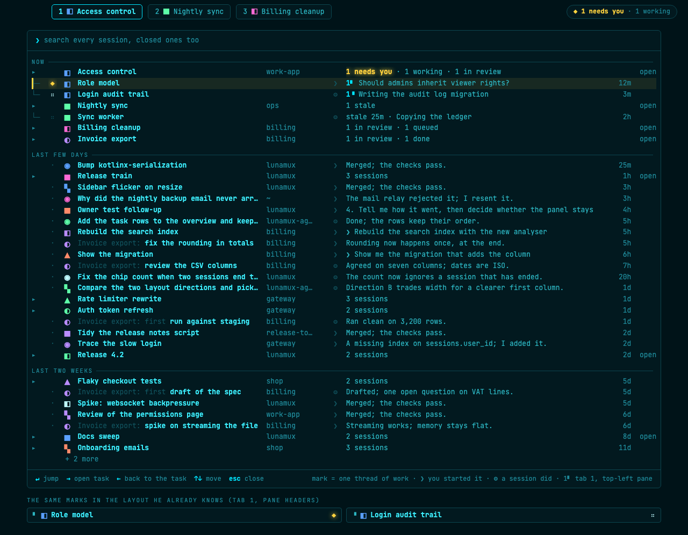
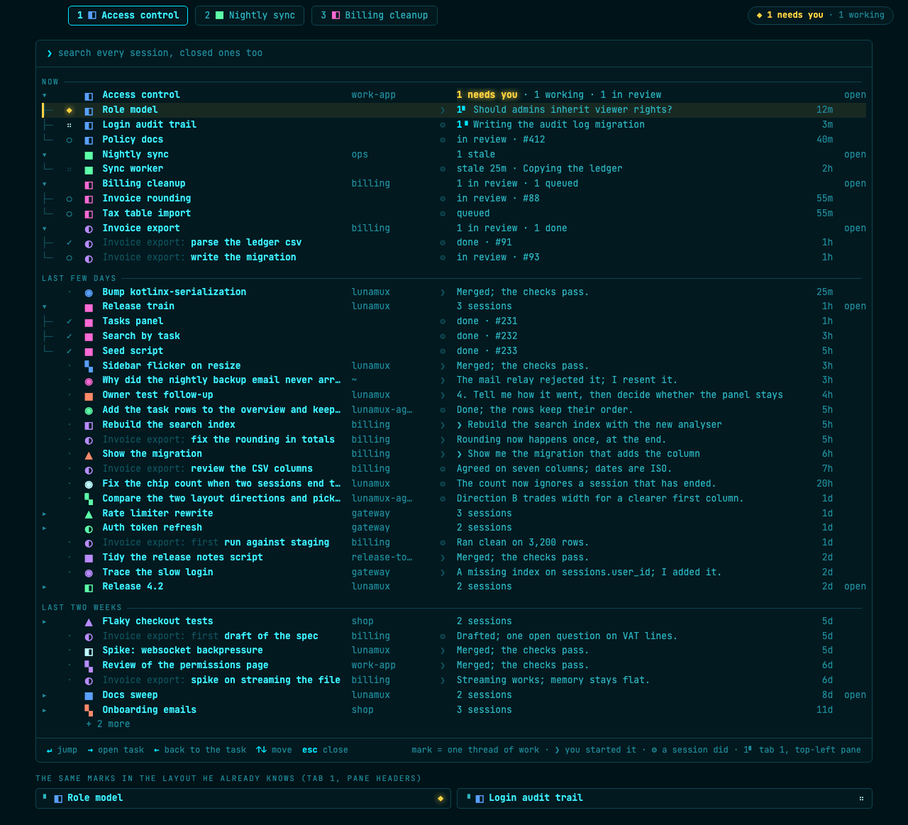
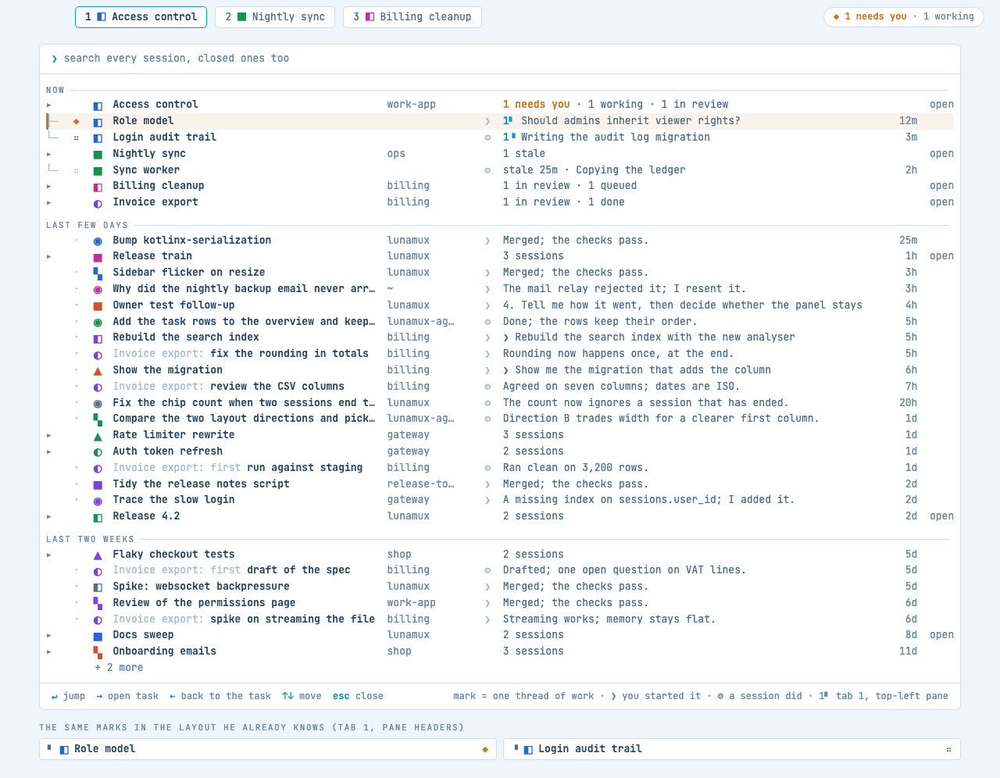
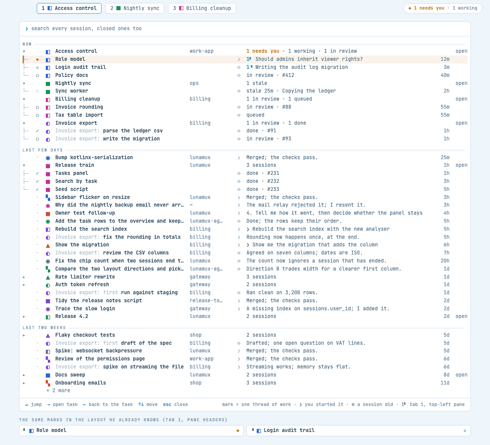

- **What it does.** A thread of work (a worktree, else branch, else folder) gets a **mark**: one of
  six shapes in one of six hues, 36 pairs, picked by a hash of the thread key and nudged past marks
  already taken, then kept in a small table so it never changes. The task header, every member row,
  the tab and the pane header all wear the same mark, so the row in the overview and the pane in the
  layout are visibly the same thing. Every Invoice export row, in a task or loose, wears the same
  half-circle mark, so the family reads as one thread without reading a title.
- **Also in this direction.** A *place* cue for live sessions (`1▘` = tab 1, top-left pane), written
  inline before the status text and only on rows that have one; a *who* cue on every row (`❯` he
  typed it, `⚙` another session started it); the words that every title in a family
  shares are **dimmed** (`Invoice export:` in grey, `parse the ledger csv` bold) so the differing words lead, rows keep a stable order within a band, and the
  ◆ row is tinted amber so it stays the loudest thing.
- **Trade-off.** Marks are an arbitrary vocabulary he has to *learn once*: the first week they mean
  nothing, and past 36 threads marks start repeating (the thread's title and place still tell them
  apart). In the light theme the shape alone carries identity for the pale hues.
- **Data source.** A thread key (worktree path, else branch, else working directory: all known to
  whatever started the session), the pane position (the layout the client already has), who started
  the session, and a persisted mark table per user (client side). No server activity data.

## B. Pulse: rhythm instead of age

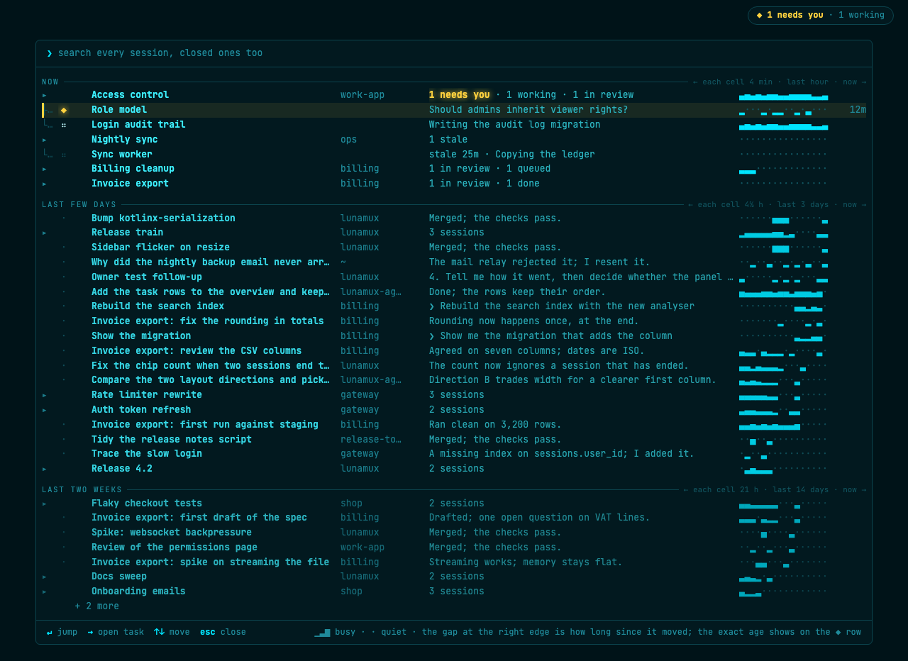
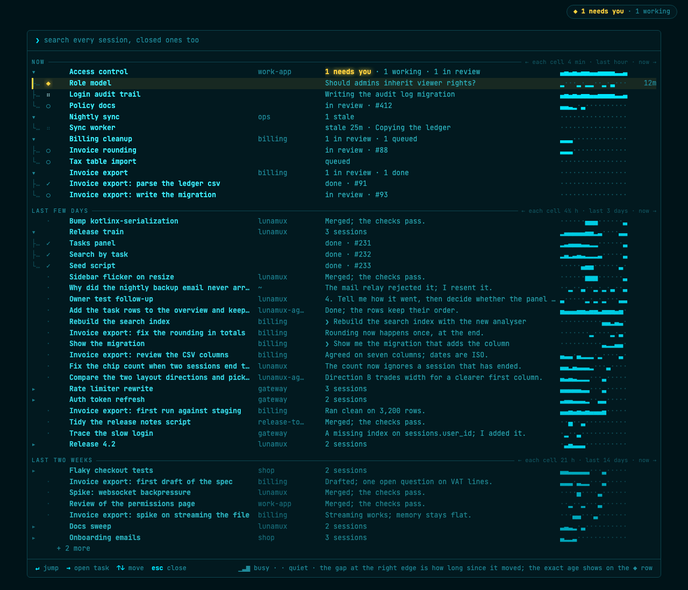
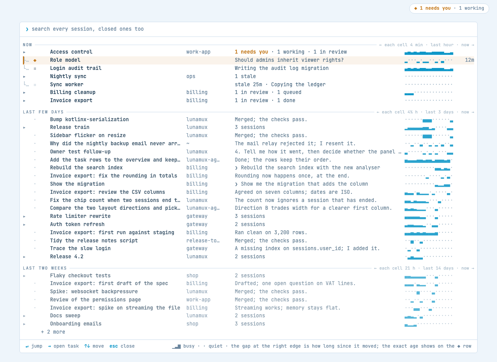
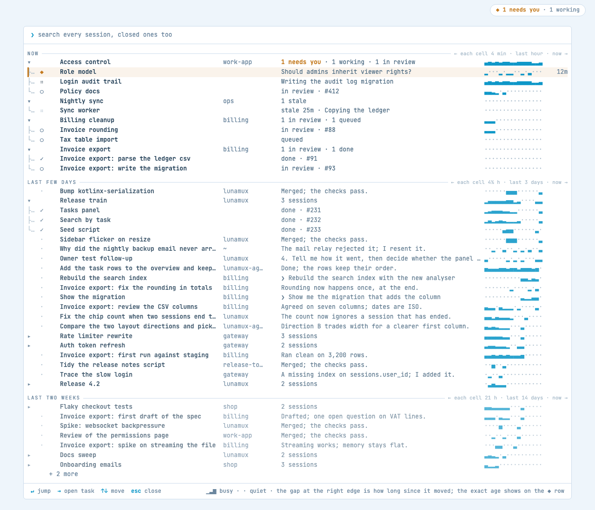

- **What it does.** The age column becomes a 16-cell strip ending at "now". A cell is 4 min in NOW, 4½ h in
  LAST FEW DAYS and 21 h in LAST TWO WEEKS (each band's header says so): a block's height is how much
  the session printed, a dot is quiet, and the gap at the right edge *is* how long since it moved
  (Role model, 12m, ends three cells before now; Bump kotlinx-serialization, 25m, ends in the last
  cell of its hours band). A manager that
  wakes, acts and sleeps looks different from an implementer that ran to the end, and different from a
  one-shot question. Rows also fade by band (NOW full, older bands quieter). The exact age shows on the ◆ row (the selected one), written after the strip.
- **Trade-off.** It answers *when and how* a session moved, not *which* one it is: two rows with the
  same rhythm are as alike as before. On finished sessions in older bands the strip collapses to one
  block near the edge, so it earns its keep on live rows and little elsewhere.
- **Data source.** New, and generic: the server counts each pane's output per minute and keeps about
  two weeks of buckets. Nothing orchestrator-specific; any terminal user has the same data. There is
  today only a single `activityMillis`.

## C. Switchboard (radical): a board with an address for every thread

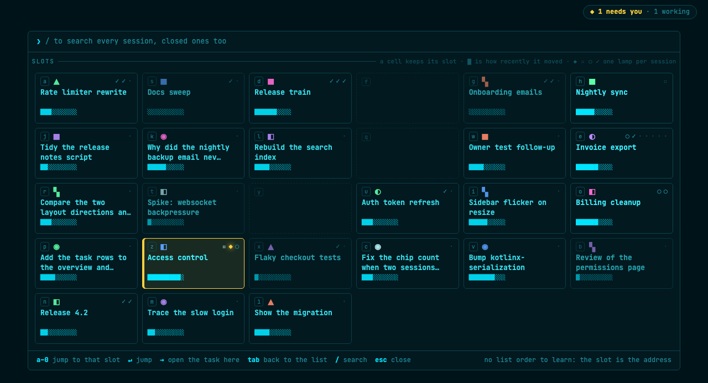
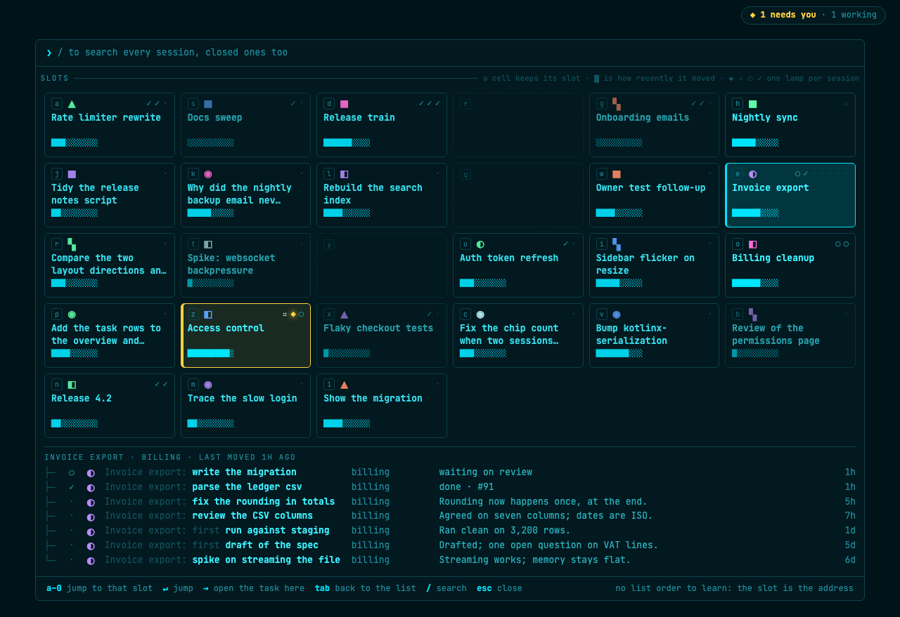
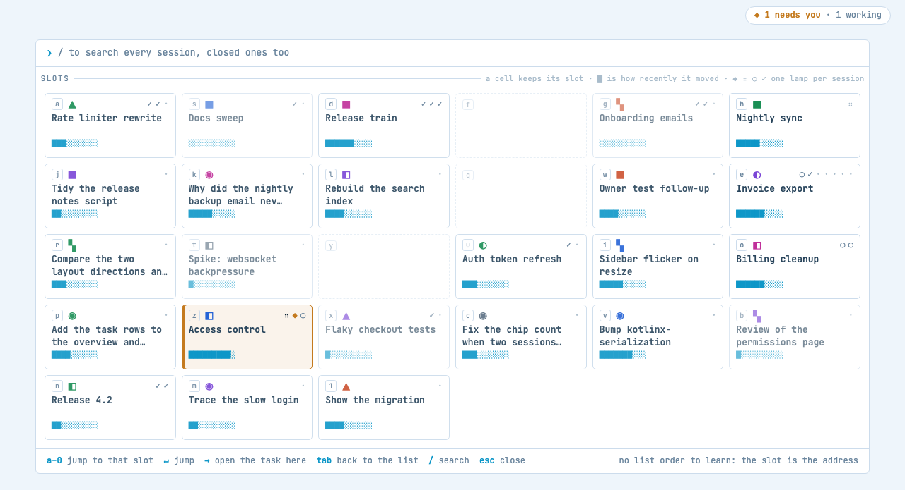
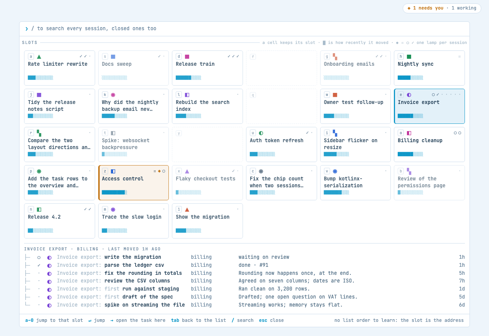

- **What it does.** The overview opens on a 6-column grid. Each thread owns a **slot** that never
  moves (home keys `a s d f g h …` then `1`–`0`): its mark, a name cut to two lines at a word boundary, one lamp per session (◆ needs
  you, ⠶ working, ○ queued, ✓ done, · closed) and a freshness bar that drains as it goes quiet. He
  stops reading a list and starts remembering a place; pressing the slot's key jumps there, and `→`
  opens the task as a drawer under the grid (the Invoice export thread in the expanded pictures, with its seven sessions and the shared
  prefix dimmed). Freed slots stay
  empty until a new thread takes them, so nothing shifts under his eyes.
- **Trade-off.** It gives up the one-line status text: only the selected slot shows what a session
  last said. Letter keys now mean "jump", so search moves to `/`. The board holds 36 slots; anything
  quieter than that waits without one. A thread is one slot, so a family like Invoice export is one cell, not seven; its
  differing sessions are in the drawer. Names are cut at 40 characters, so two threads that open with
  the same words can read alike on the board (the mark and the key still tell them apart). It is a
  different screen to learn, and it only pays if he looks at the same few threads every day.
- **Data source.** The same thread key as A, plus a persisted per-user slot table (client side).
  No server activity data.

---

## Checked while drawing

- **Colour is never the only cue.** A mark is a shape and a hue; state is always a glyph plus a
  word; the place cue is text; B's strip is block heights, not colours; C's lamps are glyphs.
  Honest limit: with shape alone, A's marks are only six classes, so for someone who cannot tell the
  hues apart a family is told apart by shape, the place cue and the differing title words.
- **◆ stays the loudest.** The hue sets leave out the warn yellow and the accent cyan; the ◆ row (A,
  B) or cell (C) is tinted amber with a bar at its edge, and the marks use mid-saturation hues next to the ◆'s full amber.
- **Seeded collisions.** In the seeded set, 24 threads need 36 possible marks: 7 threads land on a mark
  another one already holds on the raw hash, and all are resolved by probing, so none repeat. The mark table must be persisted for
  this to hold; a fresh hash alone is not enough.
- **Glyphs.** The shapes come from Geometric Shapes and Block Elements, rendered here with the overview's bundled font. The two quadrant shapes (▚ and the ◧ half-square) read
  finer than the others at 18 px; a real build should check them in the terminal's own font.

## Seeds I rejected

- **His own words** (show what he last typed into the session). Only a small share of his sessions
  carry his words at all; the rest were started by another session, so the cue would be blank
  exactly where the rows look most alike.
- **The heartbeat alone.** It is direction B, and it answers *when*, not *which*. Kept as one
  direction, not the whole answer.

## Recommendation

**Take A, and add B's band fade.** A is the only direction that attacks the actual problem (many rows
that look alike because they belong to a few threads) without a new server feed and without moving
anything he already knows; it also carries into the tab and the pane, where he looks most. If he
wants the bolder change, **C is the one to try**, and it can sit on top of A (the marks are the same)
rather than replace it. B's strip is worth it only if per-minute pane activity is acceptable to
collect, and even then for live rows rather than every row.
