# A mark for every thread of work

Every row in the agents overview that belongs to one thread of work wears the same small mark: one
of 36 (six shapes in six hues), chosen once per thread and stored, so it never changes. A task's
header and its member rows wear the task's mark; a loose session wears its thread's mark; the pane
header and the tab wear it too. The footer says what it means: "mark = one thread of work".

All pictures come from the seeded dev server (`scripts/seed-agents-overview.sh`), taken at 1280 and
1024 px in both themes, in [sigil-marks-2026-11-03/](sigil-marks-2026-11-03/).

## What a thread is

The server derives a *thread key* from where a session runs (`ThreadMarks.keyOf`), in this order:

1. a linked git worktree: `path:<worktree root>`;
2. a repository checked out on a branch that is not the default one: `branch:<repo root>#<branch>`;
3. a folder that is not a repository: `path:<folder>`;
4. the home folder, a default branch, a detached head, no folder: no thread, no mark.

A task takes the thread of its first member (its `match.folder`, else the task's open folder), and
stores it as `task:<id>`, so the header and its members agree even when no session is running.

The mark is `FNV-1a(key) mod 36`. When another thread seen in the last 14 days already holds it,
the server steps by 7 until it finds a free one; when all 36 are held it shares one. The result is
stored in `thread_marks` and read back first, so a restart, a reseed or a thread going quiet never
moves a mark. Shape is `mark / 6` (◧ ■ ◐ ◉ ▲ ▚), hue is `mark % 6`; marks 12 to 17 are the
half-circle.

## The overview

Collapsed, then with the *Invoice export* task expanded: the header, its two members and the five
loose sessions further down all wear the pink half-circle (mark 14). *Rebuild the search index* and
*Show the migration* run in the same repository on other branches and wear other marks; the
home-folder session wears none.

| | Dark | Light |
|---|---|---|
| Collapsed, 1280 | 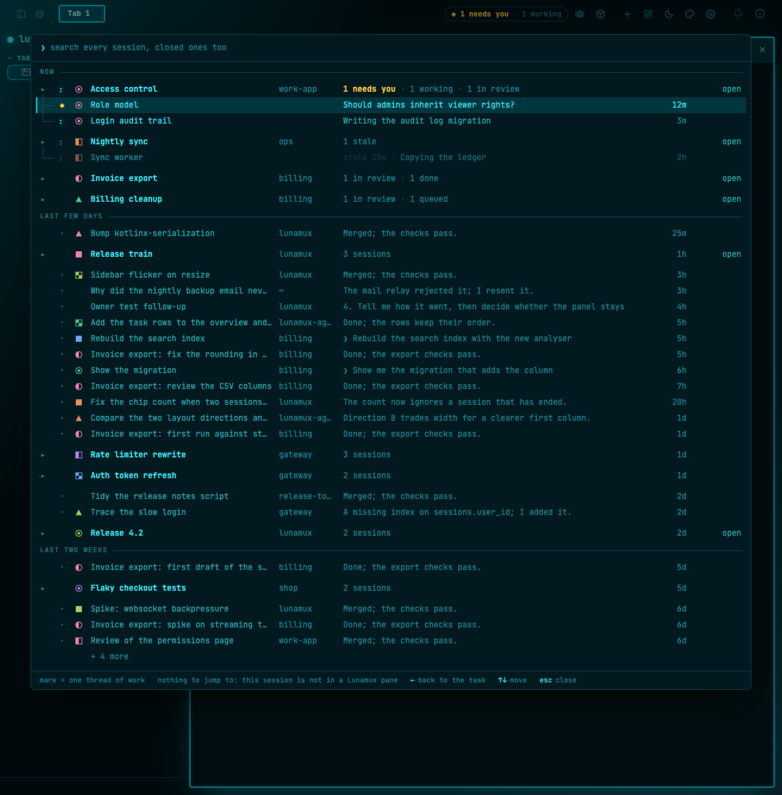 | 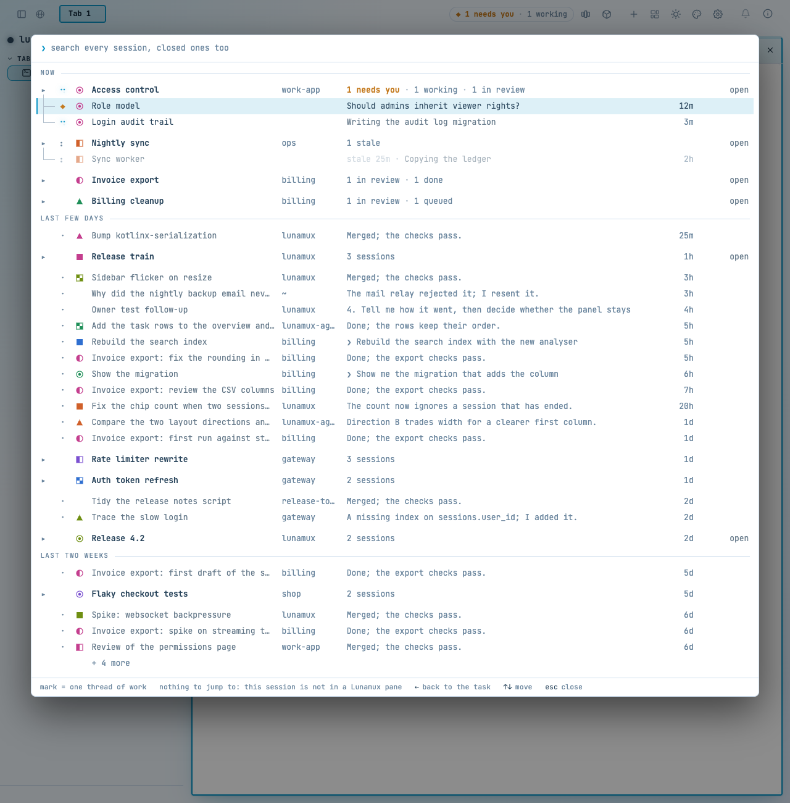 |
| Expanded, 1280 | 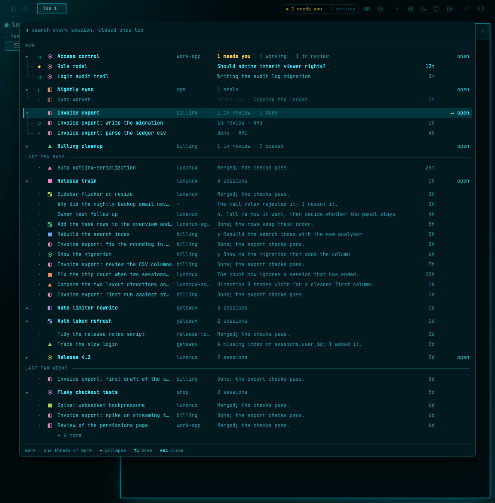 | 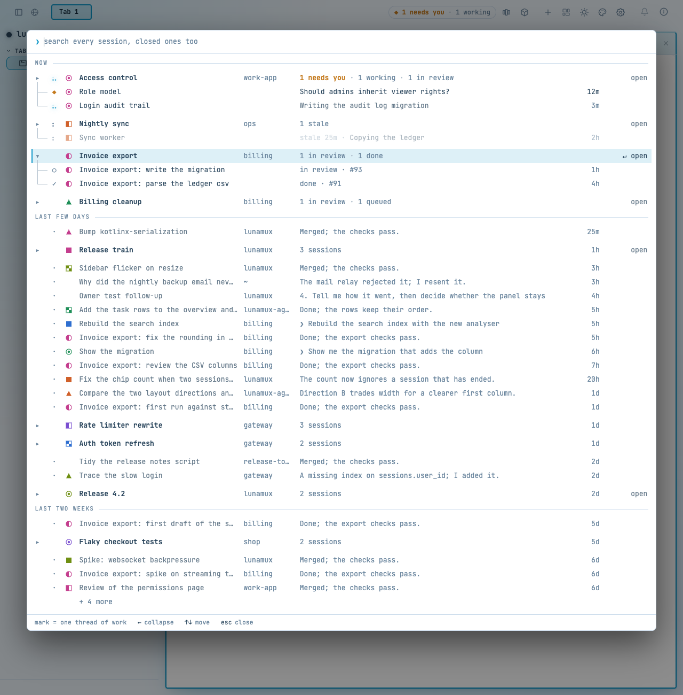 |
| Collapsed, 1024 | 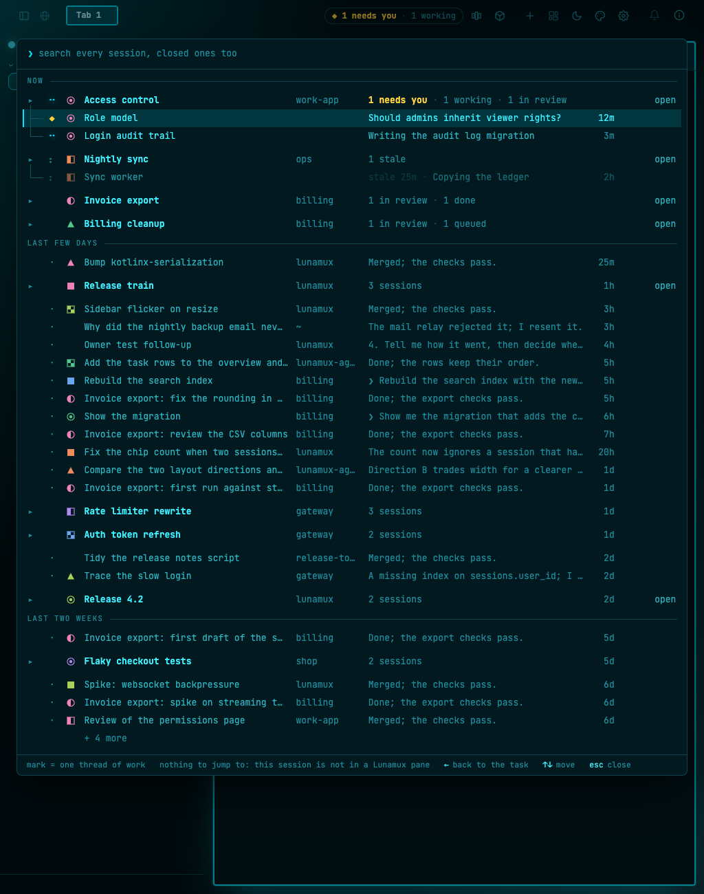 | 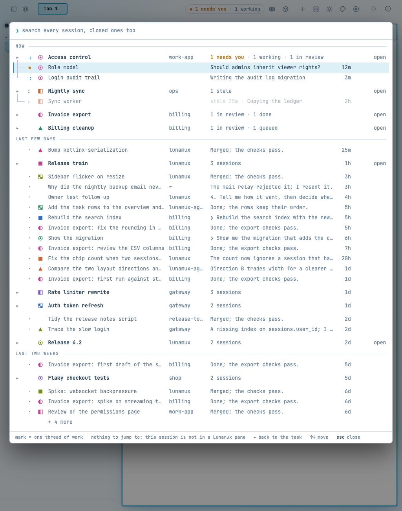 |
| Expanded, 1024 | 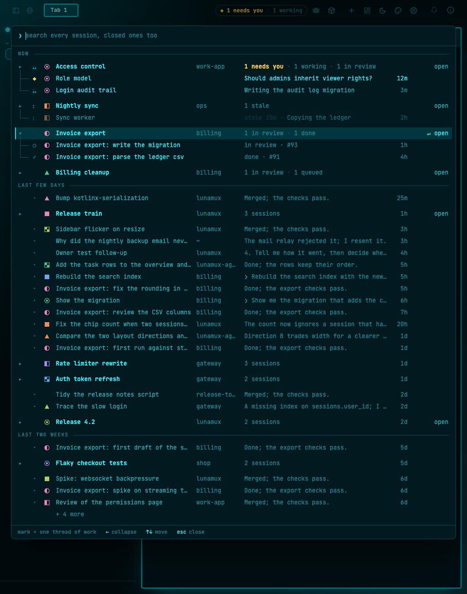 | 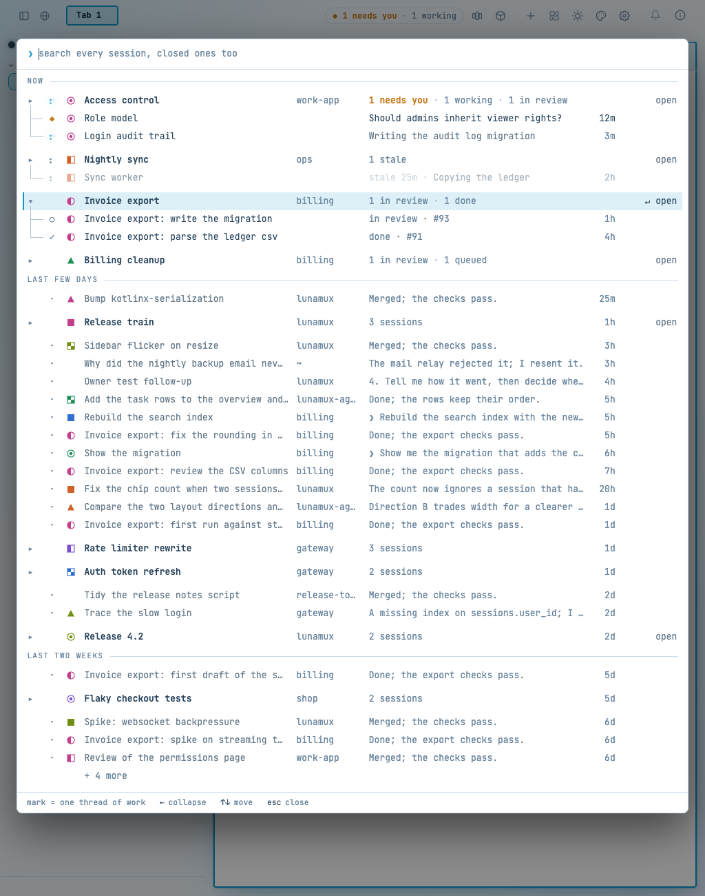 |

The six hues are `#6aa6f2 #b38af2 #ee82bd #52c98b #a9d05a #ee8c5c` on dark and
`#2f6fd0 #7a4fd0 #c43e8e #1f8f58 #6f8f12 #d0602a` on light. Neither theme's warn yellow
(`#f2c14e`, `#FFD60A`) nor the accent cyan (`#5fd4d0`) is among them, so a mark is never mistaken
for a status colour.

## The pane header and the tab

A pane running a session in the *Invoice export* worktree wears the half-circle in its header; the
tab wears it when that is the only thread in it. When the tab holds two threads, each pane keeps its
own mark and the tab wears none, because one mark would say something untrue.

| | Dark | Light |
|---|---|---|
| One thread in the tab | 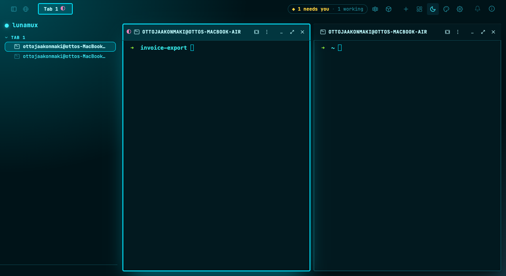 | 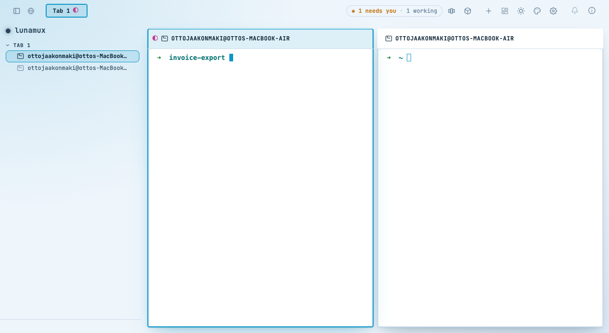 |
| Two threads in the tab | 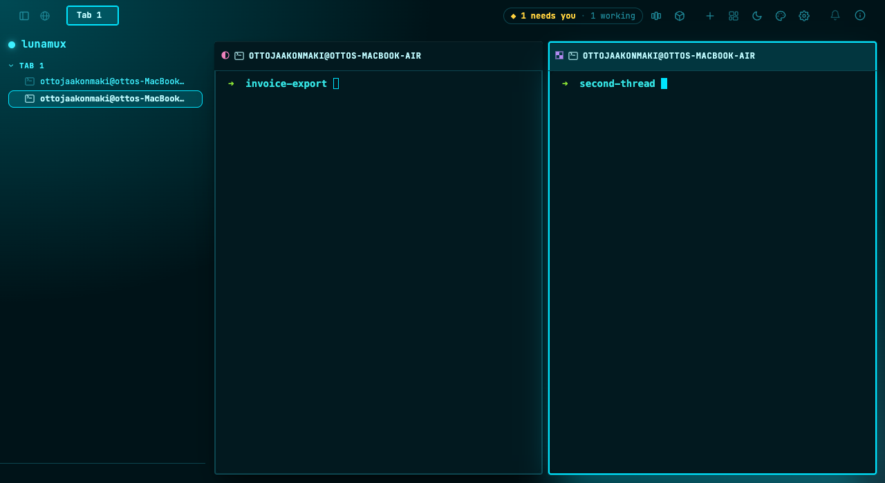 | 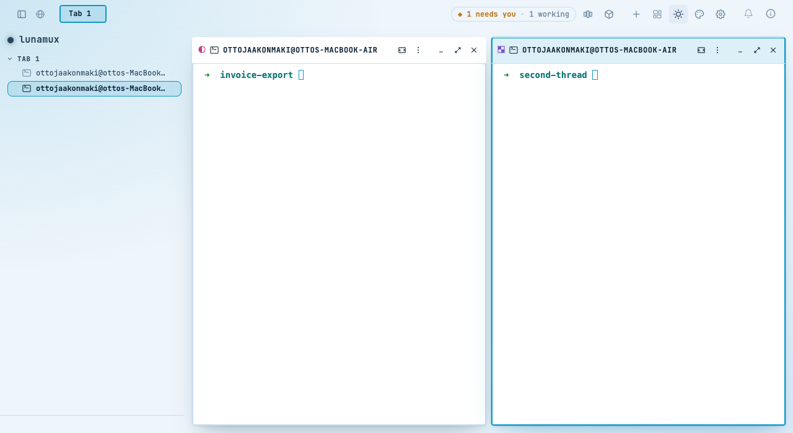 |

The mark sits before the pane title (header) and after the tab's name (tab strip); the status dot
keeps its own place.

## Code

| Where | What |
|---|---|
| `server/.../ThreadMarks.kt` | key rules, `markFor`, `markForTask`, the `thread_marks` table |
| `clientServer/.../WindowEnvelope.kt` | `mark` and `threadKey` on the session summary, `mark` on the task (both default to null, so old summaries and old clients decode) |
| `client/.../AgentsOverviewBackingViewModel.kt` | `Row.mark` |
| `web/.../SigilMarks.kt`, `styles.css` | the mark element (`.ao-sigil`, tokens `--ao-mark-0…5`), pane and tab slots |
