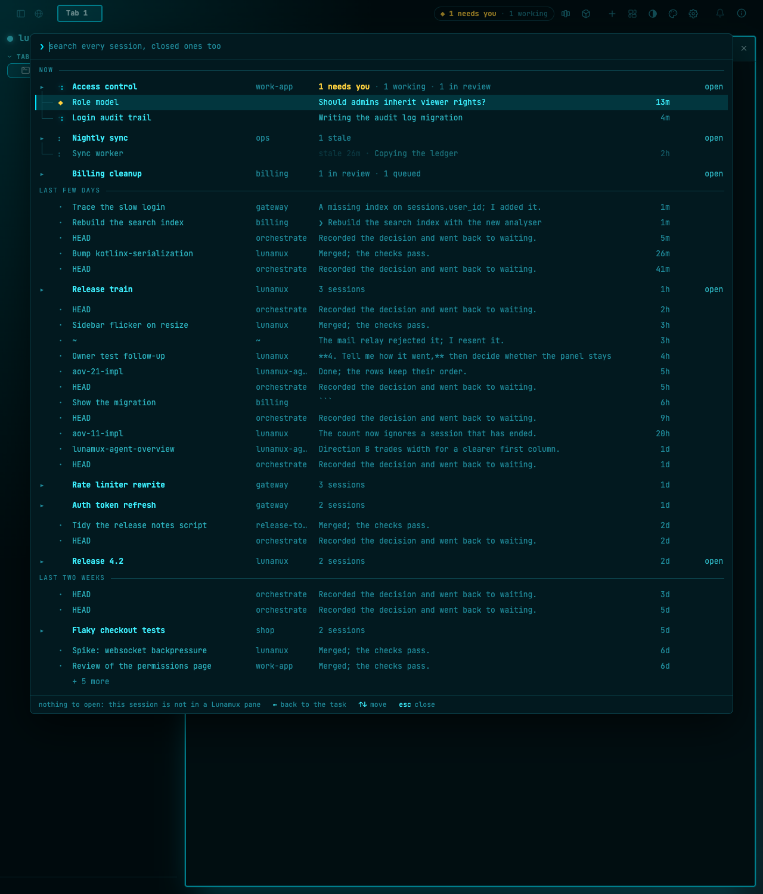
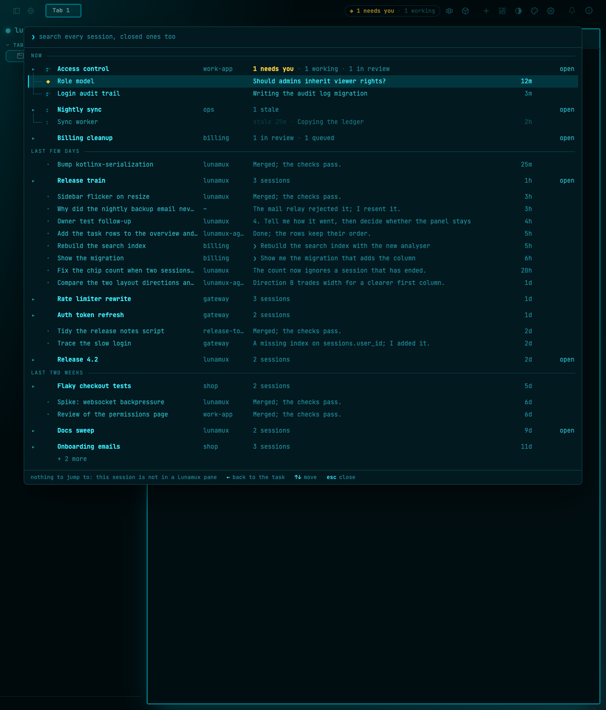
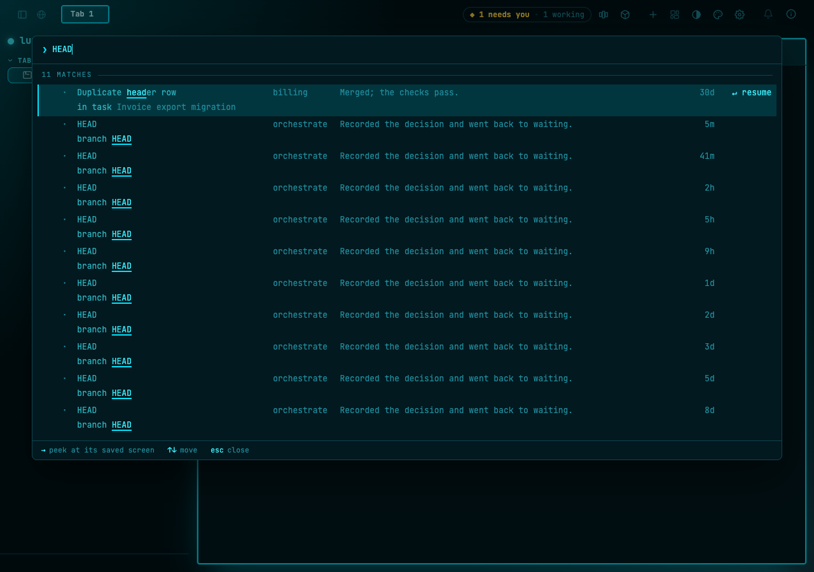
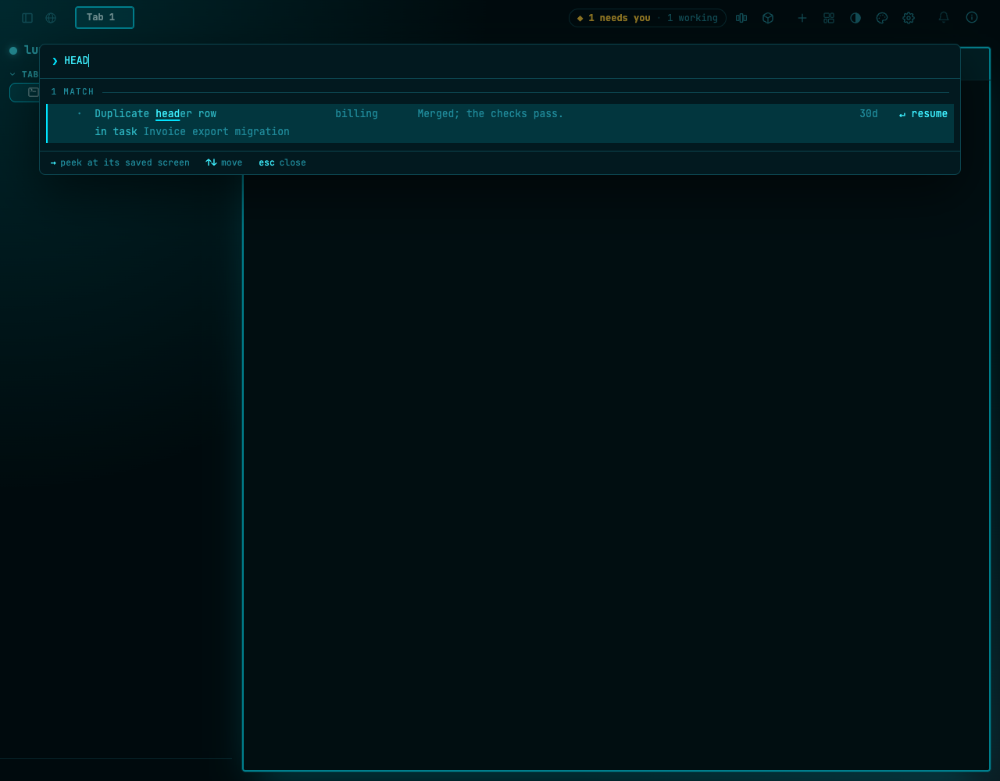
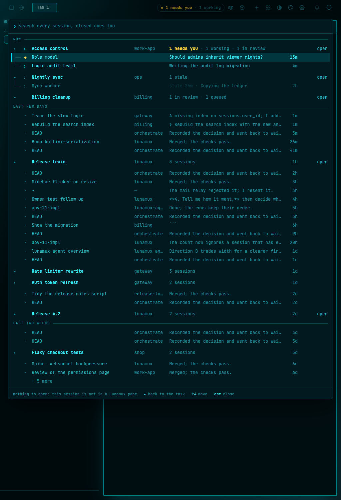
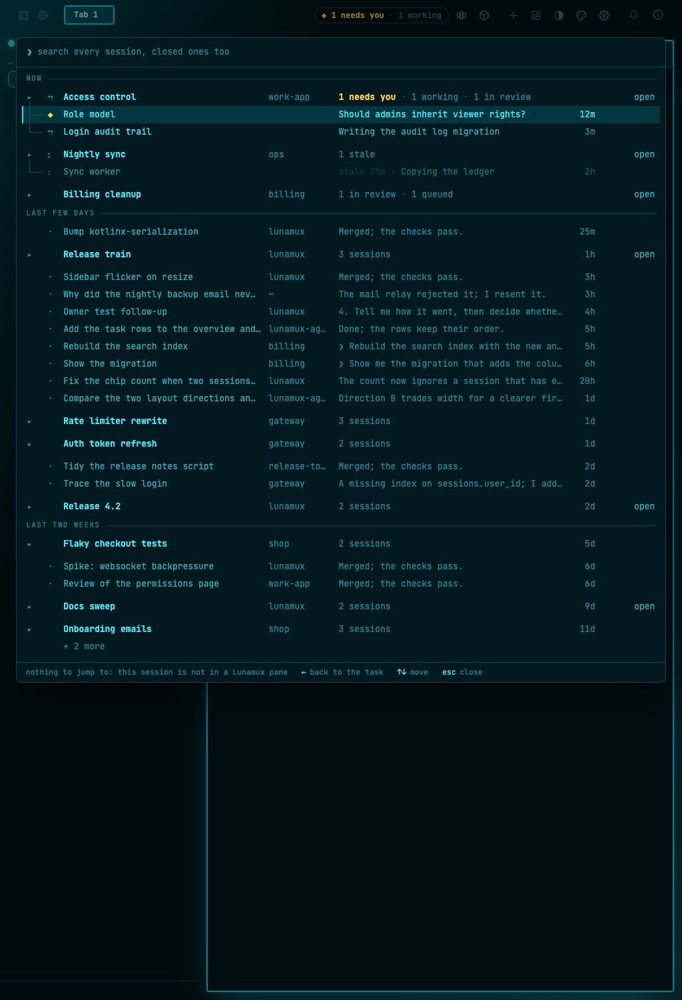
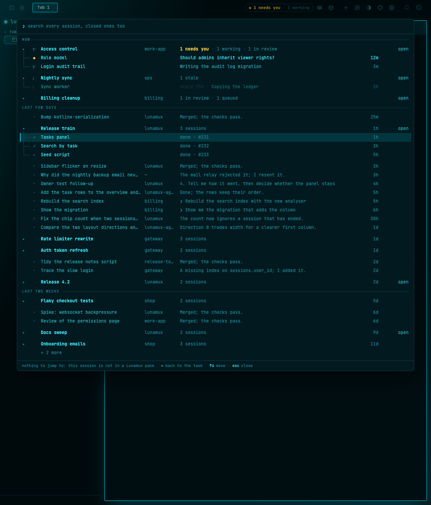

# Overview data fixes after the owner's first look

The owner opened the agents overview on real data and found seven things that were wrong, not
merely plain. Each is a data or text rule, so each is fixed where the text is made, with a test, and
the web list only shows what the view model hands it. The seeded dev server
(`scripts/seed-agents-overview.sh`) now holds every awkward case, so the before and after pictures
come from the same data. Screenshots are in [ux-fixes-2026-11-02/](ux-fixes-2026-11-02/).

## 1 · Titles say what the work is

A title is never a path, `~`, `HEAD`, the branch, the repository or folder name, or a run id. The
rule, in order: a stored title that names the work; otherwise the first words of the first prompt
(markdown stripped, a leading slash command and path words dropped, eight words at most, cut at a
word with `…`); otherwise "<Agent> session". The same rule titles list rows, a task's children and
search hits (search also stops matching a title that says nothing). Code: `AgentSessionText.titleFromPrompt`,
`isMeaningfulTitle`; `AgentsOverviewBackingViewModel.titleOf`; `AgentSessionSearch.bestField`.

| Before | After |
|---|---|
|  |  |

## 2 · Programme machinery is not the owner's work

A manager episode (first prompt "First claim the programme again…", or `/orchestrate episode`) is
started by the programme's controller, not by the owner. Search never finds one, and the search
query excludes the same prompts, so the 200-row limit is not spent on them. In the list and the
chip counts, an episode that a task already holds stays under that task, and one nothing holds is
left out. One that needs the owner is always listed ("Programme manager" when alone), so a ◆ is
never hidden.

The ticket's wording was "fold under the programme task, hide from search; choose the least
invasive". That is what the existing rules give: a session joins a task only by an explicit join,
by a file member's session id or by a task file's `match.folder` (`docs/tasks.md`, "Every session
record gets its task"), and no rule says which task is an episode's programme, so no assignment
rule was added. An episode a rule does put in a task is shown there (a file member shows as that
member); one no rule ties to a task is hidden.

| Before: search "HEAD" (11 matches) | After: 1 match, a real prompt |
|---|---|
|  |  |

The same rows were found by `~/` (the episode prompts name `~/.claude/...`), and by "first claim".
Counted in the seed database with the old search query, before the fix: `~/` 10 rows, all machinery;
"first claim" 9 rows, all machinery; `HEAD` 11 rows, 10 of them machinery. After: `~/` finds
nothing ([screenshot](ux-fixes-2026-11-02/after-search-tilde.png)), "first claim" finds nothing
([screenshot](ux-fixes-2026-11-02/after-search-firstclaim.png)), `HEAD` finds the one real prompt.
Search needs two characters, so a lone `~` cannot be typed; `~/` is the shortest query that
reaches the same rows.

## 3 · Previews are plain text

Previews drop markdown (headings, quotes, list markers, bold, italics, code ticks, links) and skip a
line that is only a code fence or a rule. The server's last-reply capture does the same, so a fence
is not stored as the reply. Words with underscores or stars inside them (`snake_case`, `2 * 3`) are
left alone.

## 4 · Bands and ages agree

Two causes. A restart ended every open record at the new start time, so a session that had been
quiet for days read "now" in the band that holds recent work. Records left open now end when the
session was last alive (its transcript's last write, never later than the restart). And a lone
session's age in an earlier band is read by the same rule as every other row (an idle or ended
session is dated by its last sign of life, in the row itself, so browsing, a task's children and
search agree). A session that has just ended gets the same ten minutes under NOW that an idle one
gets, so "now" or "1m" never sits under LAST FEW DAYS. That grace is a separate small rule and
changes nothing else about who is in NOW. Tests use a local clock at day 100, not the class clock.

| Before: rows aged 1m to 5m under LAST FEW DAYS (at the top) | After: every row's age fits its band |
|---|---|
|  |  |

## 5 · One meaning for the second column

The column is a place (repository or folder) or blank, on every row, and never a PR number. A task
member the file declares has no place of its own, so its cell stays blank rather than repeating the
task header's; a member that matched a live session shows that session's folder. The PR number
moved to the detail text (`done · #231`).

 ([before](ux-fixes-2026-11-02/before-expanded.png))

## 6 · The chip stays on one line

`.ao-chip` no longer shrinks or wraps. It is 202 px wide and 24 px high from 340 px up
([340](ux-fixes-2026-11-02/after-chip-340.png), [520](ux-fixes-2026-11-02/after-chip-520.png),
[760](ux-fixes-2026-11-02/after-chip-760.png); [before, 520](ux-fixes-2026-11-02/before-chip-520.png)).

## 7 · One hint per key, one word per action

The footer hints are made once, by `footerHints`, so `→ expand` and `space expand` cannot sit
together. One word per action: **jump** goes to a session's live pane, **resume** opens an ended
session (or a task-file member with a session id) in a new tab, and **open** is only a task
header's own action. A row with no pane says "nothing to jump to", not "nothing to open". Browsing and searching say the same word for the same action.

## Not covered

Android and iOS: the shared view model and text rules are built for them, but they were not run.
