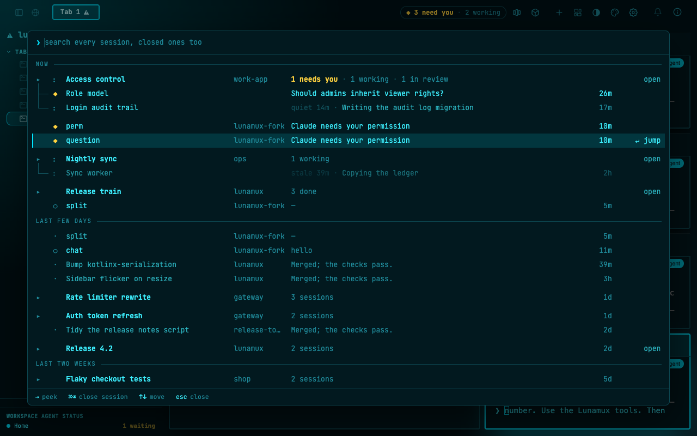
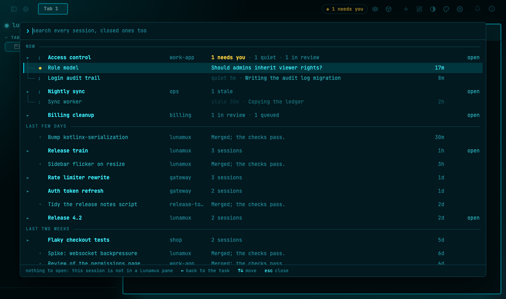
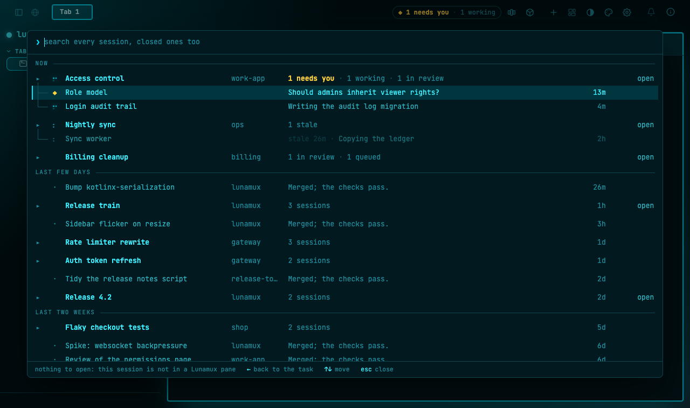

# UX/UI review of the tasks build (milestone 4)

An independent look at the agents overview (⌘⇧A) with its tasks and EARLIER bands, judged against
the owner's north star:

> **One glance, and I know where all my work stands.** What is waiting on me (a ◆ I can trust),
> what is moving (each task's sessions, live), what I've been working on (a few days up front, two
> weeks behind, the rest through search), and from any of them one key takes me there.

The reviewer did not build any of it. Everything below was seen on a running dev server, in the web
client at 1280 and 1024 px wide, on a scratch database and tasks directory (never the owner's
Lunamux), seeded with `scripts/seed-agents-overview.sh`. Findings are classed **broken** (it
contradicts the north star or is a defect: fixed in this PR with a test) or **taste** (left for the
owner, listed with a suggestion). The first pass classed two of the findings (the chip counting a quiet
session as working, and a lone session reading as a member of the collapsed task above it) as taste; the
owner called both broken, so they are now F5 and F6 and are fixed with tests.

## Verdict in one paragraph

The overview does what it is for. Opened cold on the seed it answers the three questions in one
screen: one ◆ on top, tasks grouped with their sessions, the last days in order, a quiet band for
older work, and search finds a closed session by the task it belonged to. Both live ◆ cases
worked, a chat that only finished its turn never showed ◆, and an agent told to split a job across
two panes created a task through the MCP tools without being asked to. Four things were broken and
are fixed: a finished-but-not-ended file task sat in NOW forever, every ◆ row read "Claude
needs your permission", whatever it was really asking, the toolbar chip and a task's count line called
a quiet or stale session "working", and a lone session after a collapsed task read as one of its members.

## Findings

### F1 · broken · A file task whose sessions are all done stays in NOW (the owner's input, GI-33)

"Release train" is a file task whose three sessions are all `done` and none has ended, the way a
programme looks while its pull requests wait for a merge rule. It sat in NOW under the working
tasks, expanded to three ✓ rows with nothing moving or waiting in them
([expanded](ux-review-m4/03-before-release-train.png)). With five or six finished PRs held that
way, NOW would never be quiet, and "what's moving" would be answered with work that is not moving.

Verdict: **broken**. The rule was "a file task stays while any session has not ended". It confused
*not ended* with *has work left*. A member that reads `done` has no work left, whether or not its
session still exists.

Fix: a task goes to EARLIER the moment no session needs the person or works and every session reads
done (a task file's `done`/`ready`, or a session that ended). Open work that is neither (a session
in review, queued, idle) still keeps the task in NOW, because something is left to do and the task
should not jump between bands as its sessions start and stop. The seed now holds both cases:
"Release train" (all done, lands in LAST FEW DAYS) and a new "Billing cleanup" (one in review, one
queued, stays in NOW). Tests: `aFileTaskWhoseSessionsAllReadDoneMovesToEarlierEvenThoughNoneEnded`,
`aFileTaskWithADoneSessionStaysInNowWhileAnotherNeedsYouWorksOrIsStillOpenWork`,
`aDoneOnlyFileTaskGoesToEarlierAtOnceWithoutTheGraceAHostedTaskGets`; `docs/tasks.md` and the seed
header say the new rule. Shown fixed in [the last screenshot](ux-review-m4/07-after-fix.png).

### F2 · broken · Every ◆ row says "Claude needs your permission"

Two real sessions were left waiting: one asked a plain question through `AskUserQuestion`, one hit
a permission prompt for a shell command. The ◆ and the count in the toolbar chip were right (3 need
you, matching the three ◆ rows), but both rows read *Claude needs your permission*, the hook's
generic text. The north star asks for a ◆ the person can trust and act on from a glance: with two ◆
rows saying the same thing, they cannot tell the one worth dropping everything for from the one that
is a routine `echo`, without jumping into each pane.

Verdict: **broken** (the seeded task's "Should admins inherit viewer rights?" shows what the row is
for; the live rows did not do it).

Fix: the tracker keeps the tool call that arrived just before the prompt. A question put through
`AskUserQuestion` shows the question itself; a permission prompt shows `Allow <command>?`. With no
tool call pending (a plain `Notification`) the hook's own text stays. Tests in
`AgentSessionTrackerTest`: the `AskUserQuestion` case, the keeps-the-hook-text case, and the
permission case, which now expects the command. Shown fixed in
[the last screenshot](ux-review-m4/07-after-fix.png): *Allow Bash echo hello > /tmp/aov21-play/perm.txt?*
and *Which release name do you prefer: Aurora or Borealis?*.

### F3 · pass · The four live cases

All four were started by hand in panes of the scratch server (real Claude Code sessions, hooks on).
The split prompt was: *"Split this job across two Lunamux panes with one Claude Code session in each. In your
own session count the .kt files under server/src/main. In a second pane in this same folder start a second
Claude Code session and give it the job: count the .kt files under web/src/jsMain and tell me the number. Use
the Lunamux tools. Then report both numbers."* It names the Lunamux tools but never says "task", so the
grouping was the agent's own. The owner should judge whether "Use the Lunamux tools" is too strong a nudge
for the test the owner runs.

| Case | Result |
|---|---|
| A real question (`AskUserQuestion`) | ◆ in NOW, in the chip, on the tab and in the sidebar; text fixed by F2 |
| A real permission prompt | ◆ the same way; text fixed by F2 |
| A chat that only finished its turn | idle ○ with its last line "hello", **no ◆** ([screenshot](ux-review-m4/02-before-live-cases.png)) |
| An agent asked to split a job across two panes (the prompt never says "task") | created the task "Count .kt files (server + web)" through the MCP tools with both panes in it, unprompted; one task with two sessions, "2 idle" in NOW ([screenshot](ux-review-m4/03b-split-task.png)) |

Jumping from the overview lands in the pane with its tab and sidebar entry selected
([screenshot](ux-review-m4/08-after-jump.png)).

### F4 · pass · Search finds a closed session by its task

Searching a word that only the task's title holds finds its closed sessions, each with an
`in task …` line and **↵ resume**. Width 1024 still reads cleanly
([screenshot](ux-review-m4/05-width-1024.png)): the repo column shrinks, the right edge holds.

### F5 · broken · The chip and the task line count a session that is not moving as working

The toolbar said "2 working" and the seeded "Login audit trail" (*quiet 14m*) and "Sync worker"
(*stale 39m*) were the two. The rows themselves were honest (dimmed, with the age), but the chip and
the task line "1 working" counted a session whose file had stopped speaking. First classed taste; the
owner called it broken, rightly: the north star says *what is moving*, and a quiet session is not.

Verdict: **broken**. Fix: one rule decides it for the row prefix, the chip and the task line
(`agePrefixOf` / `isMoving` in `AgentsOverviewBackingViewModel`, since removed: a session now counts as working until a hook or the screen says otherwise, see `docs/tasks.md`): a session counted as working only
while it is working and neither quiet (5 min without activity) nor stale (20 min). The chip counts
those only, and the task line names the others by their own word: *1 working · 1 quiet · 1 stale ·
1 in review*, never "working". The task header's moving glyph still follows any working member, so
a task is not shown as stopped while a session is still live. Because the chip can now fall to idle on
the clock alone, the web client keeps its 30 s clock running while any session is working even with
the overlay closed. Tests (`AgentsOverviewTasksViewModelTest`):
`theFooterCountsAsWorkingOnlyTheSessionsThatAreMovingAndTheClockAloneEndsThat`,
`aTaskLineCountsAQuietOrStaleSessionUnderThatWordAndNeverAsWorking`.

Seen on the seeded server: after five minutes without activity the chip fell from "1 needs you · 1
working" to "1 needs you", and "Access control" went from "1 working" to "1 needs you · 1 quiet · 1 in
review". One consequence the owner should know about: a quiet or stale session no longer keeps the chip at
"working", so with only such sessions left and nothing needing you the chip reads "agents idle", the
same as with nothing running. That is the rule applied literally; a "quiet" word on the chip would be a
one-line change if the owner wants it.

### F6 · broken · A lone session after a collapsed task reads as one of its members

In EARLIER the gap came before the next header, not after the task's last row, so a single session
after a task read as one of its members: in the first screenshot "Auth token refresh" is followed by
"Tidy the release notes script", and in [the after-fix one](ux-review-m4/07-after-fix.png) "Count .kt
files" by question, perm, chat, split and "Bump kotlinx-serialization". This works against "the unit
is a task". First classed taste; the owner called it broken.

Verdict: **broken**. Fix: a row that starts after a task (a collapsed header, or the last member of an
expanded panel) and is not that task's own member gets the same top margin a header gets
(`startsAfterTask`, a pure function the web list uses to add an `ao-gap` class; one rule in
`styles.css`, which is zeroed under a section label). Collapsed and expanded now space alike. Test:
`aLoneSessionRightAfterATaskGetsTheGapAHeaderGetsAndASessionOfTheTaskDoesNot`.

## Taste (left unchanged; for the owner)

T1 and T7 of the first pass are no longer here: the owner called them broken, see F5 and F6. T4 (the
footer saying "collapse" twice) was fixed afterwards, see [the data fixes](ux-fixes-2026-11-02.md).

- **T2 · The first selected row cannot be jumped to on the seed.** The overview opens on the first
  ◆ (a seeded member with no pane), so the footer says *nothing to open: this session is not in a
  Lunamux pane* ([screenshot](ux-review-m4/06-jump-and-peek-hint.png) shows a hosted ◆ with
  **↵ jump** instead). A real world has hosted sessions first; a seed artifact.
- **T3 · An idle session with nothing to say shows "—"** (the freshly started "split" row,
  [screenshot](ux-review-m4/06-jump-and-peek-hint.png)). Fine for a few seconds; an empty line would
  read calmer.
- **T5 · Ended rows with no summary show the raw first prompt**, prefixed with `❯` and cut at the
  column ([screenshot](ux-review-m4/07-after-fix.png), the "question" and "perm" rows). Readable, a
  little noisy.
- **T6 · A permission prompt for an MCP tool will read `Allow mcp__server__tool …?`** (inferred from
  the code, not seen: no MCP tool prompt was raised in the live cases, so there is no screenshot).
  That is the tool's internal id; a plain name would read better. It is still more telling than the
  generic text it replaced, so it is left for the owner to say whether it bothers them. Only a
  permission prompt gets the `Allow …?` phrasing; other notifications keep the hook's own text.
- **Limit, not a finding · Claude Code's own menus.** A "Teach auto mode about your environment?"
  menu blocked a pane while its session read idle: no hook fires for it, so Lunamux cannot know it
  is waiting. Nothing the overview can fix.

## What the review could not see

Android and iOS (out of scope for this milestone), the Electron shell (needs a desktop session),
and a real programme's long-lived sessions over hours. The seed's file-declared members have no
pane, so ↵ on them is "nothing to open" by construction.

## Re-look after the fixes

One re-look on the seeded server after the fixes ([screenshot](ux-review-m4/07-after-fix.png)):
"Release train" has left NOW and sits in LAST FEW DAYS ("3 sessions"); "Billing cleanup" (in review,
queued) holds its place in NOW; both ◆ rows say what they are asking; "Count .kt files" sits in
LAST FEW DAYS with its two sessions, but only because the restart that loaded the fixes ended all
four test panes' sessions (the old "perm", "question", "chat" and "split" rows beside it are the same
restart); the grace rule for a task of hosted sessions was not exercised on the live sessions and is
covered by its existing tests. Nothing new was found.

A second look after F5 and F6 ([T1](ux-review-m4/10-after-t1-quiet.png),
[T7](ux-review-m4/09-after-t7-gap-stale.png)), on a freshly seeded server with the clock left to run:
the chip and the task lines dropped the quiet and stale sessions by themselves at the 30 s tick, and
the lone session after the collapsed "Release train" stands apart. Nothing new was found.

## First things to try tomorrow

1. Open ⌘⇧A with nothing running: it should be calm, no ◆, the last days on top.
2. Start a Claude session and ask it something that needs a shell command: wait for the permission
   prompt, open ⌘⇧A, and read the ◆ row. It should say `Allow <the command>?`.
3. Ask a session to use `AskUserQuestion`; the ◆ row should be the question.
4. Let a chat finish a turn and check it has **no** ◆.
5. Say "split this job across two panes with a Claude Code session in each" and see whether a task
   appears with both panes in it. Then ↵ on the task header and on a session.
6. With a programme that holds finished PRs for the merge rule, check that it is in LAST FEW DAYS
   and that a task with a PR still in review stays in NOW.
7. Search a word from an old task's title and press ↵ to resume one of its closed sessions.
8. Leave a session alone for five minutes: the chip and the task line should stop calling it working
   and the row should say *quiet 5m*. In EARLIER, check that a lone session after a collapsed task is
   set apart from it.
