# UX review of Sigil (the marks, the place and who cues, the ◆ row)

A look at the agents overview (⌘⇧A) as the owner will see it, after Sigil: a mark for every thread
of work, a who cue (`❯` you started it, `⚙` a session did), a place cue (`1▘`: tab 1, top-left),
the dim task prefix, and the footer legend. Judged against the north star:

> **One glance, and I know where all my work stands.** What is waiting on me (a ◆ I can trust),
> what is moving (each task's sessions, live), what I've been working on (a few days up front, two
> weeks behind, the rest through search), and from any of them one key takes me there.

Everything below was seen on a running dev server in the web client, at 1280 and 1024 px wide, in
both themes. The server was a scratch one (its own port, database and tasks directory, never the
owner's Lunamux), seeded with `scripts/seed-agents-overview.sh`, plus a few live sessions started
by hand so the place cues had real panes behind them. Pictures are in
[ux-review-sigil/](ux-review-sigil/); nothing in them comes from the owner's own data.
Findings are classed **broken** (fixed in this PR) or **taste** (left for the owner, with the reason
and a suggestion).

## Verdict in one paragraph

Sigil does what it was built for. A task's header and its members wear one mark, a loose session
wears its thread's mark, and the pane header and the tab wear the same one, so a row leads to its
pane by its place and its mark. Four things were off and are fixed: the selected ◆ row went khaki
and the ◆ tint went olive on the dark theme (it should read amber), violet and magenta were close
enough to be taken for each other, the ring-with-a-dot and the triangle read finer than the filled
shapes, and at 1024 px the footer legend was cut off in the middle of an entry. Nothing here needed
a server or view-model change, so no Kotlin test was added; each fix is checked by measurement and
by the pictures below. What is left for the owner is taste: where a task's loose sessions sit,
and whether one hue should be the only difference inside a shape.

## Findings

### F1 · broken · The ◆ row's tint turns olive in dark and khaki when selected

| Before (dark) | After (dark) |
|---|---|
| 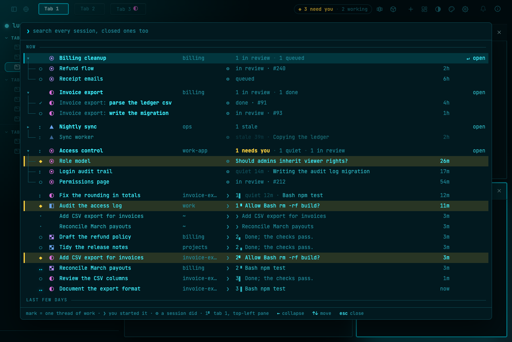 | 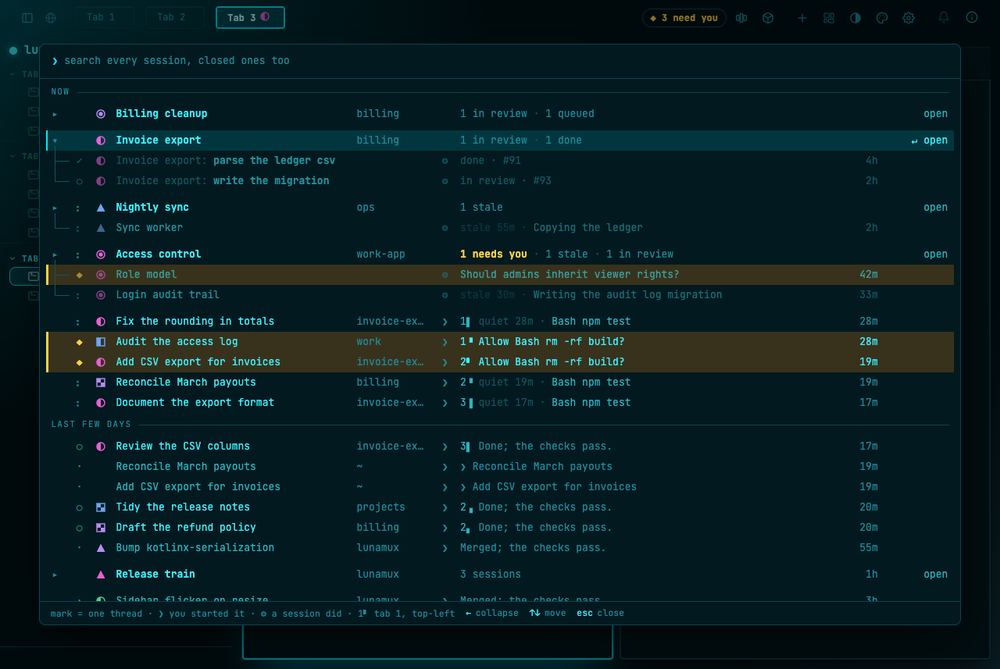 |

| Before (light) | After (light) |
|---|---|
| 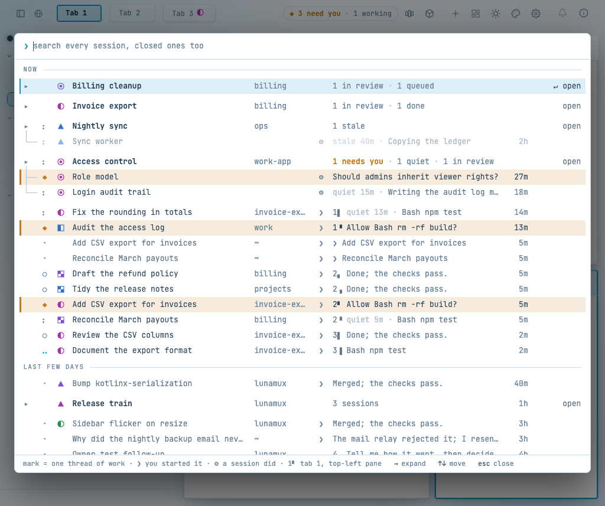 | 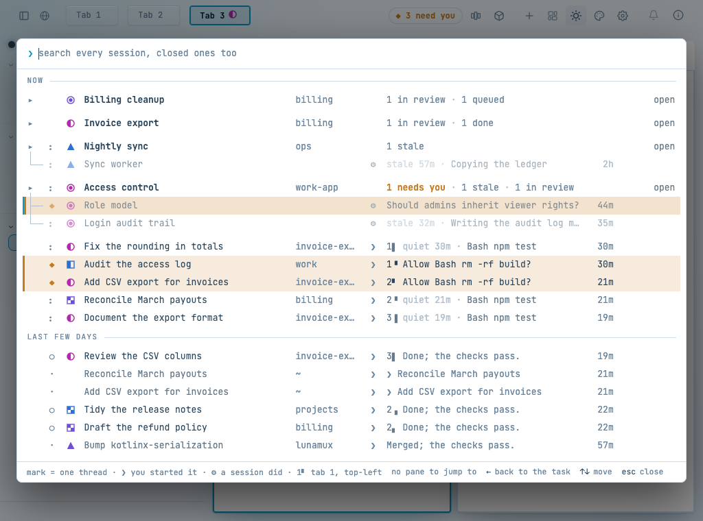 |

The ◆ row is the one thing on this screen the person must not miss. Its band was the warn colour
mixed into the panel surface with `color-mix`, and the panel surface on the dark theme is a deep
teal, so the mix drifted toward green: the band read olive, not amber, and the selected ◆ row
(accent bar plus tint) was the colour of khaki. The loudest row looked muddy and, selected, like
the dimmer rows around it.

Why it matters: this is the "◆ I can trust". A band that is the wrong colour is a band that is
easy to take for a faded row.

Done, in this PR: the tint is mixed into a neutral grey of the surface's own lightness
(`--ao-tint-base`, using CSS relative colour, with the plain surface as fallback where the browser
cannot do that), so the hue stays amber: about 46° on dark. The ◆ band is now ΔE 26 from the
surface; a plain selected row is 14.6. The selected ◆ row keeps both bars: the amber one outside
and the accent one in. See [the ◆ rows close up](ux-review-sigil/need-rows-dark.png) and
[light](ux-review-sigil/need-rows-light.png).

### F2 · broken · Violet and magenta can be mistaken for each other

| Before (dark) | After (dark) |
|---|---|
| 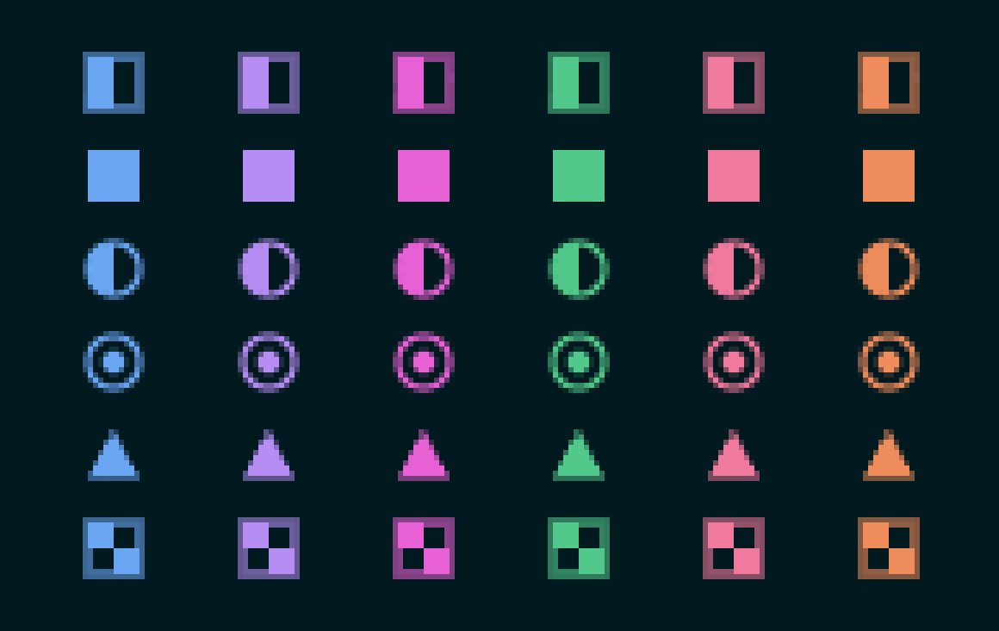 | 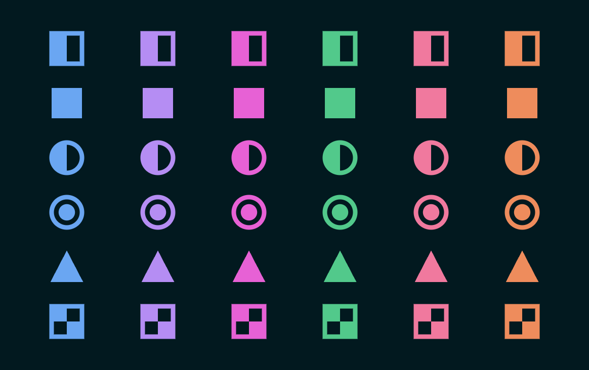 |

Marks of one shape differ only by hue, so neighbouring hues must stay apart. Measured in CIE Lab
(ΔE76) on the final palette, the closest pair was violet and magenta: 24.0 on dark and 25.7 on
light. At 12 px, next to each other in one list, those two read as one.

Why it matters: two threads of work that look like one thread break "does a family read as one
thread" the other way round.

Done, in this PR: violet moved to `#b58df3` and magenta to `#e761d5` on dark, to `#6e50d5` and
`#af2bab` on light. Every pair of neighbouring hues is now at least 32 ΔE apart
(blue–violet 33.2, violet–magenta 32.2 on dark; 32.4 and 32.4 on light), the stylesheet's marks
comment says so, and no hue is within 37 of the warn colour on dark (orange is the nearest, at 37)
or 65 on light. Which mark a thread gets did not change, only how two hues look.

### F3 · broken · The ring with a dot and the triangle read finer than the filled shapes

| Before (dark) | After (light) |
|---|---|
|  | 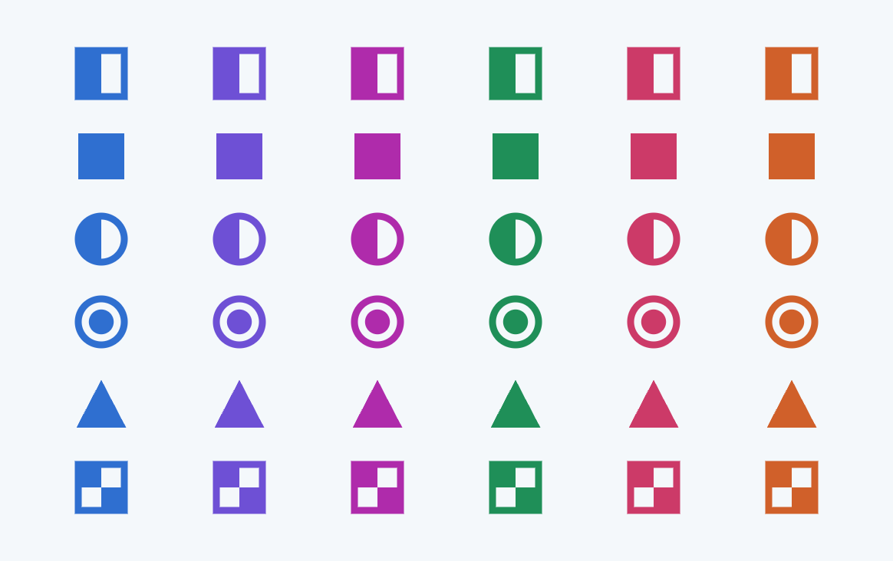 |

Measured as ink on the 12 px mark (a filled square is 100): the outline shapes were as low as 48
and the ◉ 53. A mark that reads lighter than its neighbours reads as fainter, as if that thread
mattered less.

Done, in this PR: the outline stroke goes from 1.2 to 1.5 (`.ao-sigil-line`), the ◉ dot from r 2.2
to 2.7 and the triangle about a fifth larger (it now reaches past the square's 10 px box, which a
triangle must to look as big). Ink now runs from 56 (▲) to 100 (■): ◧ 94, ◐ 74, ◉ 68, ▚ 94.
Measured at 1x on the same screen, identical in every hue. See the sheets for
[dark](ux-review-sigil/marks-sheet-dark.png) and [light](ux-review-sigil/marks-sheet-light.png).

The triangle stays the lightest shape by area; a triangle cannot carry more ink without being
bigger than its row. It still reads as a solid shape beside the others, so it was left (see taste
matter 3).

### F4 · broken · The footer legend is cut in the middle of an entry at 1024

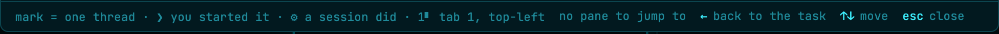

The legend (`mark = one thread of work · ❯ you started it · ⚙ a session did · 1▘ tab 1, top-left
pane`) is the key to the new cues, and it shares the footer with the key hints. When a row's hints
are the widest ones (`no pane to jump to`, `← back to the task`) the panel at 1024 px cannot hold
both, and the legend was cut off wherever the width ran out, in the middle of an entry (the old
text is in the 1280 "before" pictures above; it fitted there, which is why the cut only shows
at 1024).

Why it matters: half a legend entry is worse than none; it teaches the wrong thing.

Done, in this PR: each entry is its own element, so a narrow panel drops whole entries from the
right, and the keys never give way; the text was shortened ("mark = one thread", "tab 1, top-left")
so that at 1024 px with the widest hints the first three entries still show (the place entry goes
first). The full legend is 607 px wide at 1280; the shortened one about 511–518. The entries are
separated by a drawn "·" so a dropped entry leaves no stray dot. See [the legend at 1024](ux-review-sigil/footer-1024-dark.png)
and [light](ux-review-sigil/footer-1024-light.png).

### F5 · pass · The place cue and the mark match the pane

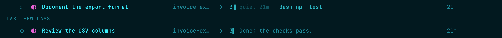
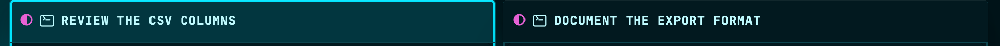

Rows for *Review the CSV columns* (`3▌`) and *Document the export format* (`3▐`) lead to the left
and right pane of tab 3, and both panes show the magenta half-circle that the rows wear. Enter on
each row opens the right tab with that pane focused. A session with no pane says "no pane to jump
to" in the footer, rather than pretending (shown in the 1024 pictures). Light:
[rows](ux-review-sigil/place-rows-light.png), [panes](ux-review-sigil/place-panes-light.png).

### F6 · pass · The tab strip and pane headers

| One thread in the tab (tab 3) | Two threads in the tab (tab 1) |
|---|---|
|  |  |
|  |  |

A tab wears a mark only when every marked pane in it shares one, and wears none when its panes hold
two threads (tab 1): a tab mark would then say something untrue. The pane headers each wear their
own mark in both cases: [one thread](ux-review-sigil/paneheader-one-thread-dark.png),
[two](ux-review-sigil/paneheader-two-threads-dark.png), and light:
[one](ux-review-sigil/paneheader-one-thread-light.png), [two](ux-review-sigil/paneheader-two-threads-light.png).
Nothing to fix.

### F7 · pass · The dim task prefix

A member named *Invoice export: parse the ledger csv* under the task *Invoice export* shows the
shared words dim and the rest bold, so the part that tells the members apart is what the eye
lands on (in the expanded pictures). A task with no shared words, and a lone member, show their
whole name as before.

### F8 · pass · Stress data

| Case | Where to see it |
|---|---|
| A long name | `invoice-ex…` truncated in the folder column; *Login audit trail*'s row text cut with `…` ([1024](ux-review-sigil/overview-dark-collapsed-1024.png)); nothing wraps or pushes the cues |
| A session with no name | the `~` rows (*Reconcile March payouts*, *Add CSV export for invoices*) show their prompt, with no mark: the home folder has no thread |
| A group of one | *Nightly sync* ([1280](ux-review-sigil/overview-light-collapsed-1280.png)) |
| A group of several | *Release train* (3 sessions), and *Access control* when expanded |
| Nothing found | [1280 dark](ux-review-sigil/search-empty-dark-1280.png), [1280 light](ux-review-sigil/search-empty-light-1280.png), [1024 dark](ux-review-sigil/search-empty-dark-1024.png), [1024 light](ux-review-sigil/search-empty-light-1024.png): the legend stays and the keys it needs |

## The five questions

**Does a family read as one thread?** Yes. *Invoice export*'s header, its two members and the
loose sessions in the same worktree all wear the magenta half-circle; the dim prefix makes
the two members read as parts of one task.

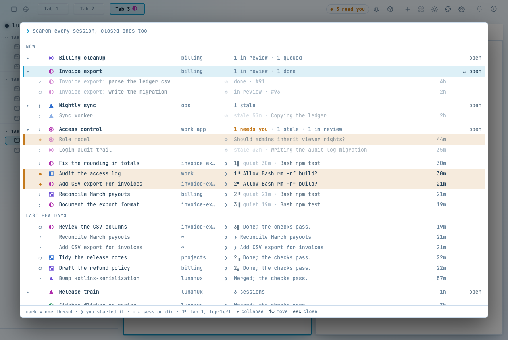

**Does a row's place cue and mark match its pane?** Yes, shown in F5. The pane header, the tab
(when it holds one thread) and the row agree on the mark, and the place glyph names the tab and
quarter.

**Is the ◆ row the loudest thing, in both themes?** Yes since F1. The band, the bar and the
bold text carry it; the task header above it says "1 needs you" in bold amber.
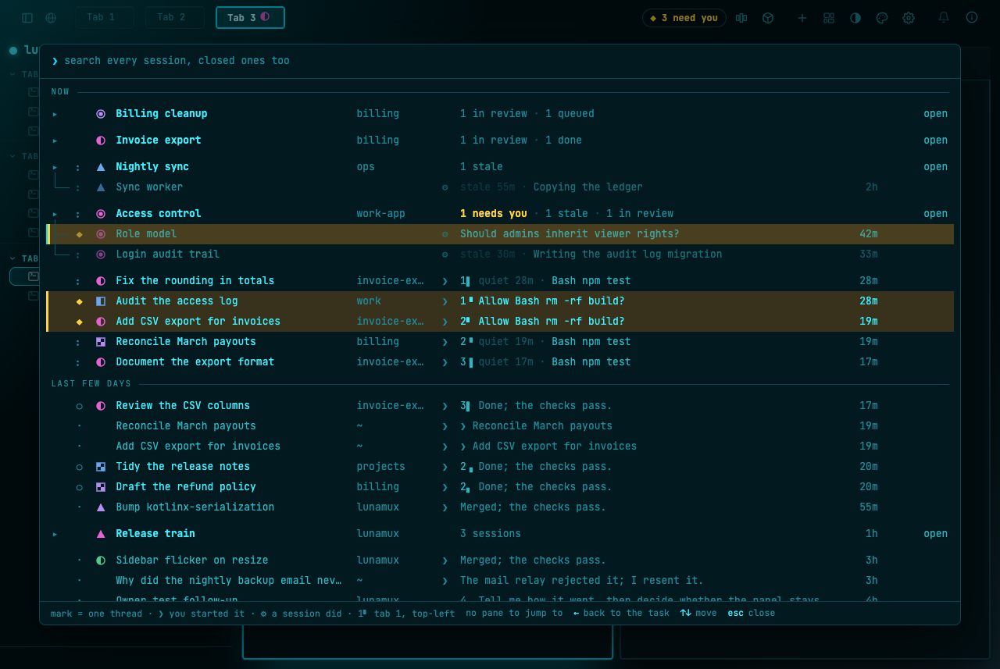
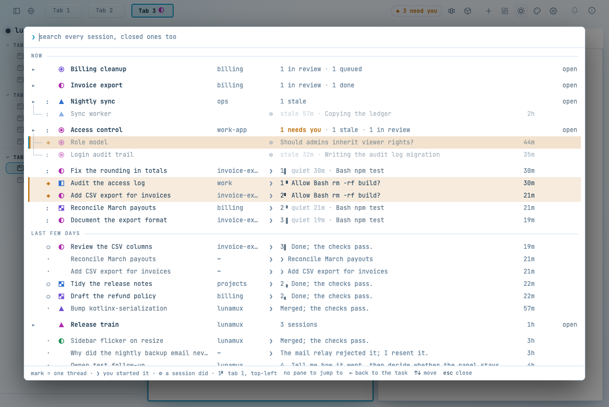

**Does any shape read finer than the others at the overview's size?** The ◉ and the outline
shapes did; now no shape is below 56 where a filled square is 100 (F3).

**Does anything rely on colour alone?** Between families, no: the shape differs. Inside one
shape, only the hue differs, by design: six marks of each shape, so a person tells the six apart
by colour. That is the one place the design rests on colour, so the hues are held at least 32 ΔE
apart (F2). The ◆ is a glyph, a bar and bold text as well as amber; the who and place cues are
glyphs; the status words say stale, quiet and done in words. I did not simulate colour-vision
deficiency, only measure ΔE (taste matter 2).

## Left for the owner (taste)

1. **Loose sessions sit away from their task.** A session that shares the task's mark but not a
   task member's folder is a loose row further down, not under the task (the seeded members have no
   folder to match). The mark joins them; the position doesn't. I left it: moving it would change
   how rows are grouped, which is outside this review. If it bothers you, group by mark under the
   task.
2. **Hue is the only difference inside a shape.** Six marks share each shape. Held at ΔE ≥ 32 and
   spread by the probing rule, they separate on screen, but a colour-blind reader would struggle
   inside a shape. If that matters, the fix is a seventh cue (a notch, a dot), which is a new cue
   and so out of scope here.
3. **The triangle is the lightest shape** (56 against the square's 100). Enlarging it more would
   make it taller than its row.
4. **The stale ◆ member fades.** *Role model* is a ◆ member of a stale task, and the older
   `.ao-stale` fade dims it while the task header says "1 needs you" in bold amber. The ◆ row
   is still readable (the band stays), but the fade says "ignore me" to a row that is asking for
   you. This is not Sigil's; I left it.

## What the review could not see

- Real, long-lived history: the seed is a few dozen rows, not two weeks of work.
- The two `~` rows labelled *Reconcile March payouts* and *Add CSV export for invoices* in the
  pictures are ended rows left when the seeded events were sent again under a new session id; they
  are an artefact of reseeding, not of Sigil.
- Mobile screens, the lunula toolkit and the owner's own data were out of scope.
- The web layer has no test harness for the stylesheet or the drawn marks, so F1–F4 are checked by
  measurement and by the pictures, not by a test. No view-model or server code changed.

## Redundancy pass

Looked for dead code in the six Sigil files (`SigilMarks.kt`, `SigilPlace.kt`, `PaneMarks.kt`,
`SigilRows.kt`, `ThreadMarks.kt`, and the overview's use of them): no declared-but-unused symbol.
`ao-sigil-badge` and `ao-sigil-slot` have no style but are DOM markers the code finds by name, so
they stay. Nothing was deleted.

## Notes on earlier documents

`sigil-marks-2026-11-03.md` lists the old hues (`#b38af2`, `#e070e0`, light `#7a4fd0`, `#ac2fb0`),
and `sigil-cues-2026-11-03.md` the old footer text. Both are dated records and are left as they
were; the values above supersede them.

## Where the code is

| What | Where |
|---|---|
| tint base and ◆ row rules, hue tokens, outline weight, footer legend | `web/src/jsMain/resources/styles.css` |
| dot and triangle geometry | `web/src/jsMain/kotlin/se/soderbjorn/lunamux/SigilMarks.kt` (`shapeParts`) |
| legend split into entries, shortened text | `web/src/jsMain/kotlin/se/soderbjorn/lunamux/AgentsOverview.kt` (`renderFooter`, `CUE_LEGEND`) |
